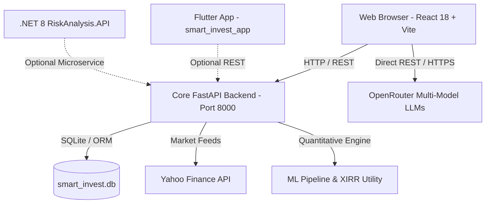

# Smart Investment Dashboard 360 — Operational Runbook

A production-grade guide for environment setup, configuration, local execution, and verification of the **Smart Investment Dashboard (LYMP)** platform.

---

## 1. System Architecture Overview

The system is organized into modular services:



| Component | Technology Stack | Default Port / URL | Purpose |
| :--- | :--- | :--- | :--- |
| **Frontend Web App** | React 18, Vite, TailwindCSS, Chart.js, Recharts, Framer Motion | `http://localhost:5173` | Interactive investor dashboard, charts, portfolio simulator, and AI assistant |
| **Backend API & ML Engine** | Python 3.10+, FastAPI, Uvicorn, SQLAlchemy, Pandas, Scikit-learn, YFinance | `http://127.0.0.1:8000` | REST API, real-time market data ingestion, risk tagging, XIRR calculations |
| **Multi-Model AI Service** | OpenRouter API (Laguna XS, Nemotron 3.5, Dots Note 3, Gemma) | Cloud HTTPS | Real-time multi-model consensus and conversational equity analysis |
| **Mobile Application** | Flutter 3.10+, Dart | Mobile / Desktop | Cross-platform portfolio & market tracking companion app |
| **Risk Analysis Microservice** | .NET 8 / C# Web API | Configurable | Enterprise risk analysis microservice endpoint |

---

## 2. Prerequisites & Environment Requirements

Before setting up, ensure the following software is installed on your system:

* **Node.js**: `v18.0.0` or higher ([Download Node.js](https://nodejs.org/))
* **npm**: `v9.0.0` or higher (bundled with Node)
* **Python**: `v3.10` to `v3.12` ([Download Python](https://www.python.org/))
* **Git**: Installed and configured on your PATH
* *(Optional)* **Flutter SDK**: `v3.10+` (only required if developing the mobile app)
* *(Optional)* **.NET 8 SDK**: (only required if developing the C# microservice)

---

## 3. Step-by-Step Setup & Installation

### Step 1: Open Terminal & Navigate to Project Root
```bash
cd SmartInvestmentDashboard_LYMP
```

---

### Step 2: Backend Setup (FastAPI & ML Engine)

1. **Navigate to the backend directory**:
   ```bash
   cd backend
   ```

2. **Create a Python Virtual Environment**:
   * *Windows (PowerShell)*:
     ```powershell
     python -m venv venv
     .\venv\Scripts\Activate.ps1
     ```
   * *Windows (Command Prompt)*:
     ```cmd
     python -m venv venv
     .\venv\Scripts\activate.bat
     ```
   * *macOS / Linux*:
     ```bash
     python3 -m venv venv
     source venv/bin/activate
     ```

3. **Install Dependencies**:
   ```bash
   pip install --upgrade pip
   pip install -r requirements.txt
   ```

4. **Initialize Environment Variables (Optional)**:
   Copy `.env.example` to `.env`:
   ```bash
   copy .env.example .env     # Windows
   cp .env.example .env       # macOS / Linux
   ```
   *(Optional)* Paste your OpenRouter API key inside `.env` if you want backend-level LLM calls:
   ```env
   OPENROUTER_API_KEY=sk-or-v1-your-key-here
   ```

5. **Initialize Database**:
   The backend auto-initializes `smart_invest.db` (SQLite) upon starting. If you want to explicitly run database setup scripts:
   ```bash
   python db_setup.py
   ```

---

### Step 3: Frontend Setup (React 18 + Vite)

1. **Open a new terminal window** and navigate to the frontend folder:
   ```bash
   cd SmartInvestmentDashboard_LYMP/react-app
   ```

2. **Install Node Modules**:
   ```bash
   npm install
   ```

3. **Configure Frontend Environment (Optional)**:
   Copy `.env.example` to `.env`:
   ```bash
   copy .env.example .env     # Windows
   cp .env.example .env       # macOS / Linux
   ```
   *(Note: You can also enter your OpenRouter key directly in the web UI using the 🔑 icon at runtime; it is stored safely in your browser's `localStorage`.)*

---

## 4. Running the Application Locally

To run the full stack, you will keep **two terminal sessions** active:

### Terminal 1: Start Backend (FastAPI Server)
```bash
cd SmartInvestmentDashboard_LYMP/backend
# Ensure virtual environment is activated
.\venv\Scripts\Activate.ps1   # (or source venv/bin/activate on Mac/Linux)
uvicorn main:app --reload --port 8000
```
* **Status Verification**:
  * Health check: `http://127.0.0.1:8000/`
  * Interactive Swagger API Docs: `http://127.0.0.1:8000/docs`
  * Redoc Documentation: `http://127.0.0.1:8000/redoc`

---

### Terminal 2: Start Frontend (Vite Dev Server)
```bash
cd SmartInvestmentDashboard_LYMP/react-app
npm run dev
```
* **Status Verification**:
  * Open your browser and navigate to: **`http://localhost:5173`**

---

## 5. Key Platform Features & Verification

Once running at `http://localhost:5173`, verify each core feature:

### 1. Market Dashboard (`/`)
* Live market indices (NIFTY 50, S&P 500, SENSEX).
* Top sector gainers & losers powered by Yahoo Finance live feeds.
* Interactive asset allocation donut charts and recent transaction histories.

### 2. Screener & Sector Leader Table (`/screener` or `/sectors`)
* Screener.in-style dense financial table.
* Displays Market Price, 1-Year Return %, P/E Ratio, Market Cap, 52-Week Range, and quantitative ML Risk Tags.

### 3. Portfolio & Sandbox Blueprint (`/portfolio`)
* Toggle between **Real Portfolio** and **Sandbox Portfolio**.
* Sandbox mode lets you simulate buys/sells with virtual funds.
* Computes real-time **Cumulative XIRR %** alongside traditional P&L metrics.

### 4. Risk Analysis Engine (`/risk`)
* Volatility metrics, Value-at-Risk (VaR), Sharpe Ratio, and sector drawdown simulations.

### 5. AI Assistant & Real Multi-Model AI Comparison (Floating Widget)
* Click the floating robot icon in the bottom-right corner.
* **Standard Chat**: Ask equity questions (e.g., *"Can I invest in ASIANPAINT.NS?"*). Powered by OpenRouter free-tier LLMs with fallback quantitative models.
* **Real Multi-Model AI Comparison**:
  1. Click the **Globe icon (🌐)** or **"Compare 5 AI Models"**.
  2. The window automatically expands to **2x width (`820px`)** with a side-by-side 2-column model grid.
  3. Live parallel inference queries multiple real LLM architectures simultaneously (`Poolside Laguna XS`, `Poolside Laguna S`, `NVIDIA Nemotron 3.5`, `Dots Note 3`).
  4. Returns individual verdicts (Bullish / Bearish / Neutral) and aggregates a % Bullish Consensus.
  5. Click **`← Back`** in the top bar to return to standard chat.

---

## 6. OpenRouter API Key Setup

The AI Assistant works both in **Offline Smart Assistant** mode and in **Live OpenRouter LLM** mode:

1. **Obtain a Free Key**:
   * Visit [openrouter.ai/keys](https://openrouter.ai/keys).
   * Sign in and click **Create Key**. Free models require no credits.
2. **Add to the Application**:
   * **Option A (Web UI - Recommended)**: Click the **Key icon (🔑)** in the AI Chatbot header, paste your `sk-or-v1-...` key, and click **Save**. Stored locally in your browser.
   * **Option B (Frontend `.env`)**: Set `VITE_OPENROUTER_API_KEY=sk-or-v1-...` in `react-app/.env`.
   * **Option C (Backend `.env`)**: Set `OPENROUTER_API_KEY=sk-or-v1-...` in `backend/.env`.

---

## 7. OpenRouter Free Tier Quotas & Rate Limits

* **Daily Cap**: **200 requests/day** for standard free accounts (~50 full multi-model comparisons per day).
* **Minute Cap**: **20 requests/minute**.
* **Concurrency Handling**: Calls are staggered by 350ms in the frontend to avoid burst concurrency throttling (HTTP 429). If rate-limited, wait 15 seconds before clicking *"Compare Live"* again.

---

## 8. Common Troubleshooting & FAQs

### Port Already in Use (Port 8000 or 5173)
* If port 8000 is occupied:
  ```powershell
  # Windows PowerShell: Find and terminate process on port 8000
  Get-Process -Id (Get-NetTCPConnection -LocalPort 8000).OwningProcess | Stop-Process -Force
  ```
* If port 5173 is occupied, Vite will automatically switch to `5174`. Check the terminal output for the active URL.

### Python `ModuleNotFoundError`
* Ensure your virtual environment is activated (`(venv)` appears in your terminal prompt).
* Re-run:
  ```bash
  pip install -r requirements.txt
  ```

### Vite Build Verification
To verify that the frontend bundles without TypeScript or CSS linting errors:
```bash
cd react-app
npm run build
```
The output will be placed in `react-app/dist/` ready for production deployment.

### SQLite Database Reset
If you need to start with a fresh database:
```bash
cd backend
python wipe_db.py
python db_setup.py
```

---

## 9. Production Deployment Summary

* **Frontend**: Deploy `react-app/dist` to Vercel, Netlify, or Cloudflare Pages.
* **Backend**: Run FastAPI with Gunicorn/Uvicorn workers on AWS EC2, DigitalOcean, Render, or Railway:
  ```bash
  gunicorn -w 4 -k uvicorn.workers.UvicornWorker main:app --bind 0.0.0.0:8000
  ```
